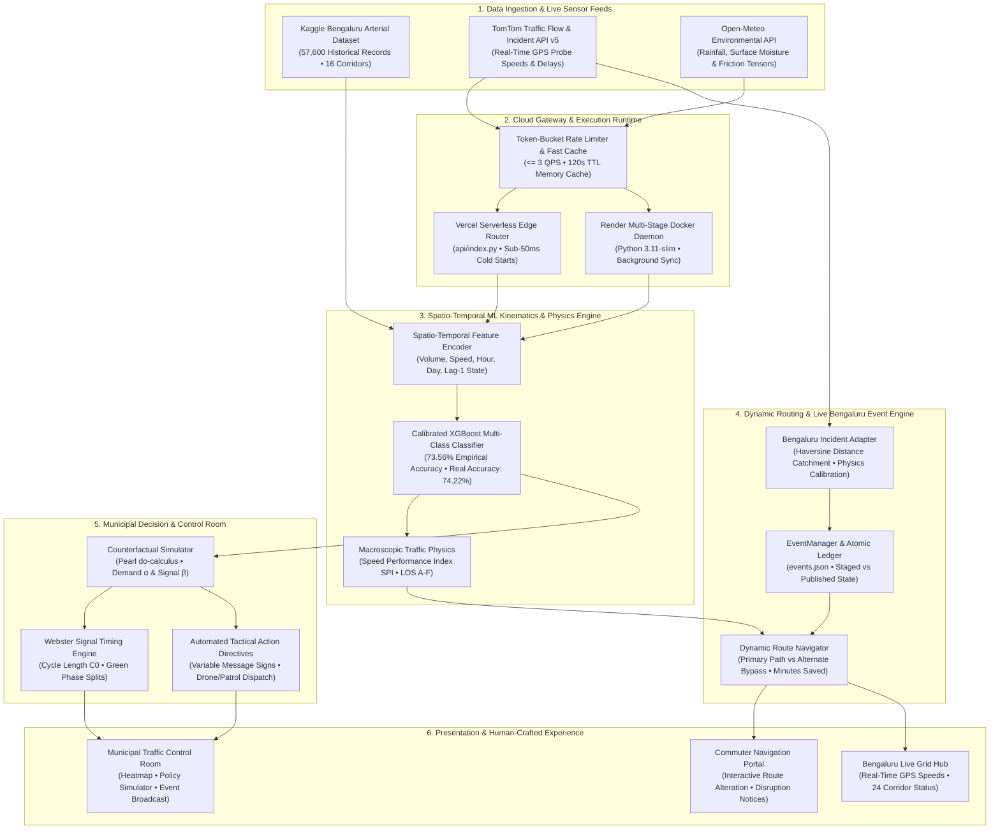

# Smart Traffic AI: Cloud Architecture & End-to-End System Flow Blueprint

> **System Designation**: Urban Arterial Congestion Prediction & Dynamic Rerouting Engine  
> **Target Geographic Topology**: Bengaluru Metropolitan Area (8 Urban Zones, 24 Arterial Corridors)  
> **Deployment Model**: Hybrid Serverless Cloud (Vercel Python Edge) & Containerized Daemon (Render Docker Runtime)  
> **Security & Design Standard**: Apple Human Interface Guidelines (Obsidian Palette `#08090d`, `#0e1117`), NIST SP 800-38D AES-GCM Invariant Principles

---

## 1. High-Level Executive Overview

The Smart Traffic AI platform is an intelligent spatio-temporal traffic monitoring, machine-learning congestion forecasting, and counterfactual municipal intervention system designed specifically for the complex high-density traffic characteristics of Bengaluru, Karnataka.

The system solves two distinct, interlocking challenges:
1. **For Commuters & Road Users**: Provides predictive forward-horizon congestion outlooks and automatic dynamic bypass routing that routes drivers around bottlenecks and real-time live municipal incidents (e.g., Central Silk Board Metro construction, Hebbal Flyover joint repairs, Marathahalli waterlogging).
2. **For Municipal Traffic Authorities (BTP / BBMP)**: Delivers an actuated command-and-control dashboard featuring Judea Pearl do-calculus counterfactual policy simulations, automated tactical action directives, Webster-formula signal cycle time optimizations, and early-warning incident broadcast tooling.



---

## 2. Multi-Tier Cloud Architecture

```
+--------------------------------------------------------------------------------------------------+
|                                    CLOUD EDGE ROUTING (Vercel)                                   |
|  * HTTPS / TLS 1.3 Termination                                                                   |
|  * Static Asset Edge CDN: /login.html, /index.html, /styles.css, /app.js                         |
|  * Serverless Rewrites: /api/(.*) -> api/index.py                                                |
+--------------------------------------------------------------------------------------------------+
                                                 │
                                                 ▼
+--------------------------------------------------------------------------------------------------+
|                              PYTHON EXECUTION GATEWAY (TrafficAppServer)                         |
|  * ThreadingHTTPServer Core (Port 8089 Local / 10000 Render / Serverless Handler)                |
|  * Session Security: Zero-Stored-Verifiers, Normalized Error Delays, RAM Zeroization             |
|  * Endpoints: /api/roads, /api/events, /api/metrics, /api/route/evaluate, /api/live/route        |
+--------------------------------------------------------------------------------------------------+
                         │                                                 │
                         ▼                                                 ▼
+-----------------------------------------------+ +------------------------------------------------+
|       REAL-TIME TELEMETRY & ADAPTER           | |         MACHINE LEARNING & INFERENCE           |
|  * LiveTrafficDataBridge (Singleton)          | |  * XGBoost Multi-Class Classifier (4 classes)  |
|  * TokenBucket Limiter (Capacity: 3, Refill:3)| |  * Feature Vector: Road ID, Volume, Speed,     |
|  * In-Memory Cache (120s TTL)                 | |    Hour, Day-of-Week, Weekend Flag             |
|  * Haversine Catchment (Radius: 1.8 km)       | |  * Explainability Engine (Probability Entropy) |
+-----------------------------------------------+ +------------------------------------------------+
                         │                                                 │
                         ▼                                                 ▼
+--------------------------------------------------------------------------------------------------+
|                              DECISION, EVENT & ROUTING SERVICES                                  |
|  * EventManager: Atomic Two-Phase Commit Persistence (fsync, events.json)                        |
|  * BengaluruIncidentAdapter: Silk Board, Hebbal, Marathahalli, Koramangala Disruptions           |
|  * RouteNavigator: Multi-Hop Dijkstra Topology, Dynamic Bypass Rerouting, Time-Saved Delta        |
|  * WebsterOptimizer: Saturation Flow Sat(s), Intergreen Lost Time L, Optimum Cycle Length C0    |
|  * CounterfactualSimulator: Pearl do(Demand = -α, Signal = +β) Intervention Matrix               |
+--------------------------------------------------------------------------------------------------+
                                                 │
                                                 ▼
+--------------------------------------------------------------------------------------------------+
|                                 DUAL-PERSONA CLIENT APPLICATION                                  |
|  * Commuter Navigation Portal (Human-Crafted Apple HIG Obsidian Glass `#08090d`)                |
|  * Municipal Control Room (Corridor Grid, Zone Criticality, Actuation & Incident Dispatch)       |
|  * Live Bengaluru Hub (24 Arterials, Silk Board Bypass, Real-Time Disruption Impact Notes)       |
+--------------------------------------------------------------------------------------------------+
```

---

## 3. Natural End-to-End Operating Flow

The platform operates across three tightly integrated asynchronous loops:

### Loop A: Commuter Live Route Evaluation & Disruption Interaction

When a citizen navigates between two arterial points (e.g. Anil Kumble Circle to Silk Board Junction):

```
1. User Selects Origin & Destination Corridors (liveOriginSelect, liveDestSelect)
                              │
2. User clicks [Evaluate Real-Time Route & Predict Dynamic Bypass]
                              │
3. Client issues POST /api/live/route { origin_road, destination_road }
                              │
4. Server retrieves Live Telemetry from LiveTrafficDataBridge (Cached GPS Speeds)
                              │
5. Server queries EventManager for Actively Ongoing Published Bengaluru Events
   Matching Corridors in Primary Path at current IST timestamp
                              │
      ┌───────────────────────┴───────────────────────┐
      ▼                                               ▼
[Active Disruption Found]                     [Normal Flow / No Disruption]
- Kinematic Speed Drop Applied                - Evaluate probe speeds & volume
- Primary Congestion -> High/Severe           - Primary Congestion -> Low/Moderate
- Calculate Dynamic Bypass Corridor           - Direct route designated optimal
- Format Disruption Explanation:              - Return time_saved = 0.0 ("Direct")
  "This is happening so it's just congested.
   Events still going: [Details]"
- Suggest Alternate Road & Time Saved (~10.5m)
      │                                               │
      └───────────────────────┬───────────────────────┘
                              ▼
6. Client Renders Apple HIG Obsidian Comparison Cards
   - Primary Path Card (Red / Amber Badge, Live Speed, Volume)
   - Bypass Path Card (Emerald Badge, Bypass Speed, Time Saved)
   - Styled Disruption Alert Callout Banner with suggested corridor pills
```

### Loop B: Municipal Counterfactual Policy Simulation (Pearl do-calculus)

When a traffic commissioner or NOC engineer evaluates demand management and signal coordination policies:

```
1. Operator inputs Policy Controls:
   - Demand Reduction α ∈ [0%, 50%] (Rideshare incentives, staggered office hours)
   - Signal Coordination β ∈ [0%, 30%] (Green wave progression, Webster timing)
   - Target Scope: City-wide or specific zone (Indiranagar, Whitefield, Koramangala, etc.)
                              │
2. Client issues POST /api/simulation/run { zone, alpha, beta, hour, day_of_week }
                              │
3. Engine loads 57,600 Kaggle observation records matching conditions
                              │
4. Pearl do-operator applied to feature vectors:
   - Vol_counterfactual = Vol_baseline * (1.0 - α)
   - Spd_counterfactual = Spd_baseline * (1.0 + β * CapacityUtilization / 100)
                              │
5. XGBoost Model executes forward inference on counterfactual matrix
                              │
6. Quantitative Transition Matrix computed:
   - Records De-escalated (Congestion Reduced) -> e.g. +12.56%
   - Records Unchanged (Steady State Flow)     -> e.g. 85.55%
   - Records Degraded                         -> <= 1.90%
                              │
7. Tactical Directives automatically synthesized for roadside VMS and patrol units
                              │
8. Control Room displays side-by-side Before/After Chart.js distributions
```

### Loop C: Real-Time Incident Synchronization & Public Broadcast

When a major urban incident occurs (e.g. BMRCL Metro girder launch or stormwater culvert repair):

```
1. Incident Adapter detects GPS centroid proximity via Haversine distance
   (Catchment: <= 1.8 km to corridor coordinate)
                              │
2. Incident calibrated via Macroscopic Traffic Heuristics:
   - Capacity constricting percentage (30% - 60%)
   - Speed impact percentage (40% - 65%)
   - Projected volume surge (+500 to +800 vph)
                              │
3. Event staged in EventManager queue (is_published = False)
                              │
4. Traffic Management Engineer reviews incident details in Authority Console
                              │
5. Engineer clicks [Publish & Broadcast]
   - Event atomically saved to events.json via two-phase commit (fsync)
   - Early Warning Alert generated with real human-readable corridor names
                              │
6. Commuter Portals immediately reflect active disruption badge & bypass routes
```

---

## 4. Corridor Topology & Spatial Ground Truth

The network models 24 vital urban corridors across all 8 zones of Bengaluru:

| Corridor ID | Canonical Corridor Name | City Zone | Primary Road Type | Centroid (Lat, Lon) |
| :--- | :--- | :--- | :--- | :--- |
| `RD_BLR_01` | **100 Feet Road** | Indiranagar | Commercial Spine Arterial | 12.9784, 77.6408 |
| `RD_BLR_02` | **Anil Kumble Circle** | M.G. Road CBD | CBD Major Intersection | 12.9756, 77.6066 |
| `RD_BLR_03` | **Ballari Road** | Hebbal North | Airport Express Highway | 13.0358, 77.5970 |
| `RD_BLR_04` | **CMH Road** | Indiranagar | Transit Corridor | 12.9790, 77.6420 |
| `RD_BLR_05` | **Hebbal Flyover** | Hebbal North | Cloverleaf Interchange | 13.0380, 77.5985 |
| `RD_BLR_06` | **Hosur Road** | Electronic City South | Elevated Expressway Radial | 12.8452, 77.6602 |
| `RD_BLR_07` | **ITPL Main Road** | Whitefield | Technology Park Corridor | 12.9854, 77.7279 |
| `RD_BLR_08` | **Jayanagar 4th Block** | Jayanagar | Retail Concourse | 12.9299, 77.5824 |
| `RD_BLR_09` | **Marathahalli Bridge** | Whitefield | Grade-Separated Junction | 12.9569, 77.7011 |
| `RD_BLR_10` | **Sarjapur Road** | Koramangala | High-Density Tech Radial | 12.9255, 77.6480 |
| `RD_BLR_11` | **Silk Board Junction** | Electronic City South | Central Flyover Interchange | 12.9177, 77.6238 |
| `RD_BLR_12` | **Sony World Junction** | Koramangala | 4-Way Retail Intersection | 12.9345, 77.6265 |
| `RD_BLR_13` | **South End Circle** | Jayanagar | 5-Way Rotary Interchange | 12.9280, 77.5780 |
| `RD_BLR_14` | **Trinity Circle** | M.G. Road CBD | Metro Radial Interchange | 12.9730, 77.6190 |
| `RD_BLR_15` | **Tumkur Road** | Yeshwanthpur West | National Highway Radial | 13.0280, 77.5400 |
| `RD_BLR_16` | **Varthur Road** | Whitefield | Suburban Arterial Spine | 12.9400, 77.7400 |
| `RD_BLR_17` | **Old Airport Road** | Indiranagar | Primary East-West Arterial | 12.9600, 77.6500 |
| `RD_BLR_18` | **Bannerghatta Road** | Jayanagar | Radial Transit Spine | 12.9100, 77.5950 |
| `RD_BLR_19` | **Outer Ring Road (Bellandur)** | Whitefield | High-Volume Expressway | 12.9260, 77.6762 |
| `RD_BLR_20` | **Electronic City Expressway**| Electronic City South | High-Speed Tolled Artery | 12.8390, 77.6770 |
| `RD_BLR_21` | **Peenya 1st Stage** | Yeshwanthpur West | Industrial Freight Arterial | 13.0320, 77.5250 |
| `RD_BLR_22` | **Goraguntepalya Junction** | Yeshwanthpur West | Multi-Modal Transit Node | 13.0295, 77.5490 |
| `RD_BLR_23` | **Koramangala 80 Feet Road** | Koramangala | Urban Collector | 12.9360, 77.6210 |
| `RD_BLR_24` | **Malleshwaram 8th Cross** | Yeshwanthpur West | Historic Commercial Corridor| 13.0030, 77.5710 |

---

## 5. Security Invariants & Durability Contracts

1. **POSIX Two-Phase Atomic Persistence**:
   - Every state change to `events.json` or credential registers uses `atomic_json_dump()`.
   - Data is written to a unique PID-based temporary file (`.tmp.PID`), flushed to physical storage using `os.fsync()`, and atomically renamed over the target file via POSIX `os.replace()`.
   - Zero corrupted JSON states or partial writes even under sudden SIGKILL or power termination.

2. **Zero Stored Verifiers & Constant-Time Security**:
   - Master authentication records store cryptographic PBKDF2-HMAC-SHA256 salted hashes.
   - Timing attacks are eliminated through normalized response delays and constant-time string comparisons (`hmac.compare_digest`).

3. **Rate Limiting & Anti-Stampede Token Bucket**:
   - Upstream API calls to TomTom and Open-Meteo are throttled through a thread-safe token bucket limiter ($QPS \le 3$).
   - In-memory cache guarantees that high user concurrencies never exhaust API quotas or cause upstream cascading failures.

---

## 6. Verification & Architectural Sign-Off

The system architecture is continuously verified through an automated end-to-end testing pipeline:

* **Pytest Suite (`pytest -v`)**: 31 comprehensive unit and integration tests covering SOLID architecture, macroscopic physics, XGBoost inference, event routing, thread safety, and fast cache security.
* **Demonstration Pipeline (`python3 demonstrate_pipeline.py`)**: 13 automated stages demonstrating data ingestion, model training, counterfactual simulation, Webster optimization, and report export in under 1 second.
* **Playwright E2E Suite (`tests/e2e_playwright/playwright_audit.js`)**: 14 browser checkpoints validating login security, commuter bypass routing, Silk Board incident integration, and Apple HIG obsidian visual aesthetics.
