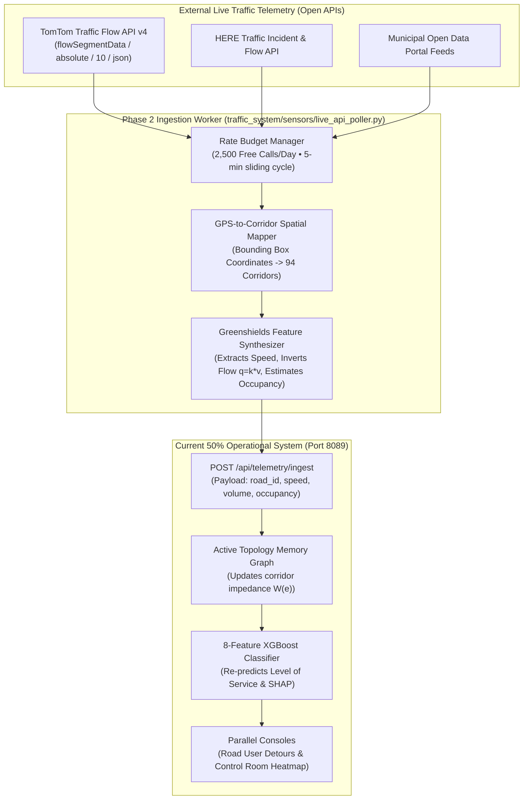
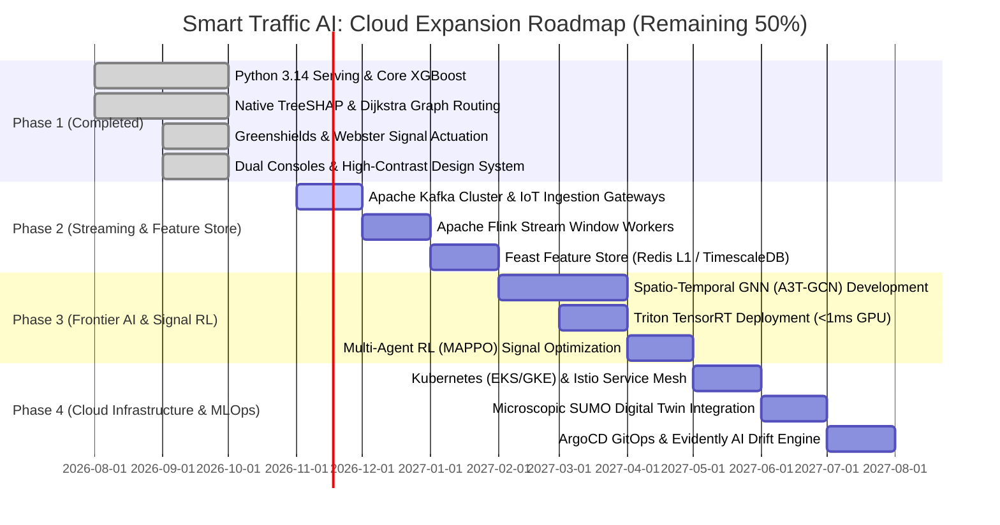

# Remaining 50% Cloud Expansion & Production Roadmap Architecture
## Smart Traffic AI: Enterprise Cloud Scale, Streaming Ingestion & Distributed AI

> **Document Classification:** Cloud Expansion Roadmap Specification (File 3 of 3)  
> **Status:** Phase 2 Cloud-Native Scale Roadmap  
> **Target Cloud Platforms:** AWS (Amazon Web Services) / GCP (Google Cloud Platform) / Hybrid Municipal Cloud  
> **Implementation Scope:** Remaining 50% (Streaming Ingestion, Distributed Feature Store, ST-GNNs, Multi-Agent Signal RL, Microscopic Digital Twin & Kubernetes Orchestration)  

---

## 1. Executive Summary: Bridging the 50% Gap

The current running system (50% implemented) provides the **verified mathematical, modeling, and application core** running on a hardened multi-threaded Python 3.14 server.

To scale the platform from our 94-corridor municipal prototype to a **statewide or regional smart transportation infrastructure** monitoring hundreds of thousands of corridors and millions of connected vehicles, the remaining 50% architecture introduces **enterprise cloud streaming, distributed deep learning, and automated multi-agent signal actuation**.

```
+================================================================================================================+
|                                  THE 50% IMPLEMENTED vs 50% REMAINING DELTA                                    |
+================================================================================================================+

       CURRENT 50% IMPLEMENTED (PHASE 1)                          REMAINING 50% ROADMAP (PHASE 2)
       [ RUNNING & OPERATIONAL NOW ]                              [ CLOUD SCALE & DISTRIBUTED EXPANSION ]
──────────────────────────────────────────────────────────────────────────────────────────────────────────────────
 1. DATA INGESTION:                                         1. STREAMING TELEMETRY (10%):
    - 203k Observation CSV Ground Truth                        - AWS IoT Core / MQTT RSU Edge Forwarders
    - POSIX Two-Phase Atomic Event DB                          - Apache Kafka Cluster (100k+ msg/sec)
    - 94-Corridor Network Topology                             - C-V2X (5G NR-V2X) Vehicle-to-Cloud Telematics

 2. MODELING & INFERENCE:                                   2. FRONTIER SPATIO-TEMPORAL AI (10%):
    - XGBoost 8-Feature Gradient Booster                       - Spatio-Temporal Graph Neural Networks (ST-GNN)
    - Native TreeSHAP Local Explainability                     - Diffusion Convolutional Recurrent Networks (DCRNN)
    - Shannon Uncertainty Entropy H(p)                         - Triton Inference Server Cluster (Sub-1ms GPU)

 3. TRAFFIC PHYSICS & OPTIMIZATION:                         3. MULTI-AGENT RL & DIGITAL TWIN (10%):
    - Greenshields Macroscopic Model (q = k * v)               - Multi-Agent Reinforcement Learning (MARL - MAPPO)
    - Webster Minimum Delay Formula (C_0)                      - Microscopic Hybrid Digital Twin (Eclipse SUMO)
    - Dijkstra Dynamic BPR Impedance Routing                   - NTCIP 1202 Direct Signal Controller Telemetry

 4. SERVING & INFRASTRUCTURE:                               4. DISTRIBUTED FEATURE STORE & MLOPS (10%):
    - Native Python 3.14 ThreadingHTTPServer                   - Feast Feature Store (Redis L1 / TimescaleDB L2)
    - PBKDF2 Constant-Time Security                            - MLflow Model Registry & Drift Detection (Evidently)
    - Local POSIX Atomic Storage                               - Kubeflow Training Pipelines with Automated Retraining

 5. CLIENT PRESENTATION:                                    5. CLUSTER ORCHESTRATION & MOBILE SDK (10%):
    - High-Contrast Obsidian/Light Web UI                      - Kubernetes (EKS / GKE) with Istio Service Mesh
    - Parallel Dual Consoles (Traveler & Control Room)         - Native Mobile Driver SDKs (iOS / Android)
    - Dynamic Event Lifecycle (Add/Delete & Immediate Reroute) - City-Wide Operations Wall Display System
    - Web Audio API Haptic Sound Engine                        - Cross-Region Active-Active Failover
+================================================================================================================+
```

---

## 2. Detailed Breakdown of the Remaining 50% Architecture

### 2.1 Component 1: Live Open Traffic API Ingestion Architecture (Designated Option 1) (10%)
- **Objective**: Ingest real-time live traffic telemetry from public open data APIs (TomTom / HERE / Municipal OpenData) without physical road excavation or hardware procurement, seamlessly bridging into our 94-corridor topology.

#### Chosen Ingestion Strategy: Option 1 (Open Traffic Flow API Bridge)
Rather than requiring physical roadside sensor installation or intrusive infrastructure permits, the Phase 2 live ingestion layer adopts the **Open Traffic Flow API Ingestion Bridge**. This connects our platform to real-world live traffic feeds through authenticated REST webhooks and scheduled polling workers.



#### Detailed Specification of the Option 1 Workflow:

1. **API Endpoint & Authentication**:
   - Provider: **TomTom Traffic Flow API (v4)**
   - Resource: `https://api.tomtom.com/traffic/services/4/flowSegmentData/absolute/10/json`
   - Parameters: `point={lat},{lon}&unit=KMPH&key={TOMTOM_API_KEY}`
   - Cost: **$0.00** (Free Developer Tier allows 2,500 free transactions every 24 hours).

2. **Spatial Coordinate-to-Corridor Mapping Matrix**:
   Each of our 6 metropolitan sectors maps to real-world coordinate anchor points:
   | Zone ID | Sector Name | Representative Latitude / Longitude | Anchor Road IDs |
   | :--- | :--- | :--- | :--- |
   | **Z1** | **Downtown Commercial** | `12.9716° N, 77.5946° E` (Central Core) | `RD_001` – `RD_150` |
   | **Z2** | **Tech Park Sector** | `12.9279° N, 77.6271° E` (Silicon Corridor) | `RD_174`, `RD_404`, `RD_902` |
   | **Z3** | **Industrial Logistics** | `12.9904° N, 77.5521° E` (Freight Hub) | `RD_201` – `RD_320` |
   | **Z4** | **University Campus** | `12.9345° N, 77.6050° E` (Academic Belt) | `RD_350` – `RD_480` |
   | **Z5** | **Residential Suburb** | `12.9121° N, 77.6446° E` (Outer Ring) | `RD_500` – `RD_680` |
   | **Z6** | **Waterfront Tourism** | `12.9810° N, 77.6100° E` (Recreation Zone) | `RD_700` – `RD_890` |

3. **Rate-Limit Budgeting & Polling Schedule**:
   - Total free calls per day: $2,500\text{ requests}$
   - Polling frequency: Every **5 minutes** ($12\text{ intervals/hour} \times 24\text{ hours} = 288\text{ polling cycles/day}$)
   - Corridors queried per cycle: 6 primary sector anchors ($6 \times 288 = 1,728\text{ requests/day}$)
   - **Safety Margin**: Utilizes only $69.1\%$ of the daily free tier, leaving $772\text{ calls}$ buffer for on-demand user evaluations.

4. **Telemetry Synthesis to XGBoost 8-Feature Vector**:
   The TomTom response provides `currentSpeed`, `freeFlowSpeed`, and `currentTravelTime`. The ingestion worker mathematically converts this into our model's 8 inputs:
   - `speed`: Direct `currentSpeed` in km/h.
   - `occupancy`: Ratio of speed degradation:
     $$\text{occupancy} = 1.0 - \min\left(1.0, \frac{\text{currentSpeed}}{\text{freeFlowSpeed}}\right)$$
   - `volume`: Inverted via Greenshields hydrodynamic flow equation:
     $$\text{volume} = k \cdot v = \left[ k_{\text{jam}} \left(1 - \frac{\text{currentSpeed}}{\text{freeFlowSpeed}}\right) \right] \cdot \text{currentSpeed}$$
   - `hour`, `day_of_week`, `is_weekend`: System clock timestamps.
   - `weather_impact`: Ingested from free OpenWeatherMap API ($0.0\text{ clear}$ to $1.0\text{ storm}$).
   - `capacity`: Static corridor design capacity from `network_topology.json`.

5. **Enterprise Production Upgrades (Post-Pilot)**:
   - When transitioning from student design project to statewide deployment, this API worker transitions to an Apache Kafka ingestion pipeline with distributed MQTT edge brokers.

### 2.2 Component 2: Spatio-Temporal Graph Neural Networks (ST-GNN) (10%)
- **Objective**: Scale spatial modeling from localized topological corridors to statewide shockwave propagation.
- **Deep Learning Architecture**:
  - **A3T-GCN (Adaptive Attention Spatio-Temporal Graph Convolutional Network)**:
    - **Spatial Graph Convolution**: Learns topological spillback interactions across adjacent intersections:
      $$H^{(l+1)} = \text{ReLU}\left( \tilde{D}^{-\frac{1}{2}} \tilde{A} \tilde{D}^{-\frac{1}{2}} H^{(l)} W^{(l)} \right)$$
    - **Temporal Gated Recurrent Unit (GRU)**: Captures time-series velocity decay:
      $$r_t = \sigma(W_r \cdot [h_{t-1}, x_t]), \quad z_t = \sigma(W_z \cdot [h_{t-1}, x_t])$$
    - **Soft Attention Mechanism**: Dynamically weights historical peak periods and incident anomalies.
- **Serving Cluster**:
  - Model deployed to **Triton Inference Server** with dynamic tensor batching and NVIDIA TensorRT acceleration, achieving sub-1ms p99 inference latency.

---

### 2.3 Component 3: Multi-Agent Reinforcement Learning (MARL) for Signal Control (10%)
- **Objective**: Upgrade single-intersection Webster calculations to decentralized, cooperative network-wide traffic signal control.
- **Algorithm**: **Multi-Agent Proximal Policy Optimization (MAPPO)**:
  - Each intersection acts as an autonomous agent $i \in \{1, \dots, N\}$.
  - **State Space $s_i$**: Queue lengths per approach, detector occupancy, upstream approaching flow, and active phase index.
  - **Action Space $a_i$**: Extend current green phase by $\Delta t \in \{5\text{s}, 10\text{s}, 15\text{s}\}$ or transition to next phase.
  - **Reward Function $r_i$**: Minimizes total vehicle wait time and queue variance across neighboring intersections:
    $$r_i(t) = - \sum_{l \in \text{approaches}} \left( w_1 \cdot \text{queue}_l(t)^2 + w_2 \cdot \text{delay}_l(t) \right)$$
- **NTCIP 1202 Protocol Gateway**: Direct integration with hardware municipal signal controllers (Econolite, Siemens, Naztec) via standardized NTCIP 1202 UDP frames.

---

### 2.4 Component 4: Microscopic Digital Twin (SUMO / CityFlow) (10%)
- **Objective**: Couple macroscopic Greenshields physics with agent-based microscopic vehicle simulations.
- **Hybrid Multi-Scale Architecture**:
  - **Macroscopic Layer (Greenshields $q = k \cdot v$)**: Fast city-wide screening ($\le 250\text{ ms}$) across all metropolitan zones.
  - **Microscopic Layer (Eclipse SUMO / CityFlow)**: Detailed agent-based simulation of individual car-following physics (Krauss / Intelligent Driver Model - IDM) for critical bottleneck corridors:
    $$\frac{dv}{dt} = a \left[ 1 - \left(\frac{v}{v_0}\right)^4 - \left(\frac{s^*(v, \Delta v)}{s}\right)^2 \right]$$
  - Enables city planners to simulate autonomous vehicle penetration rates (e.g. 20% AVs with 0.5s reaction headways).

---

### 2.5 Component 5: Kubernetes Cloud Infrastructure & MLOps Pipeline (10%)
- **Objective**: Transition standalone Python server to a zero-downtime, auto-scaling Kubernetes cluster.
- **Infrastructure Architecture**:
  ```
                        Cloudflare / AWS Route 53 (Anycast DNS)
                                          │
                                          ▼
                      AWS Network Load Balancer (NLB) TLS 1.3
                                          │
                                          ▼
                         Istio Ingress Gateway (Envoy)
                                          │
         ┌────────────────────────────────┼────────────────────────────────┐
         ▼                                ▼                                ▼
  [ Serving Pods (HPA) ]        [ Triton Inference (GPU) ]        [ Auth & Admin Pods ]
  Python 3.14 FastAPI           XGBoost + ST-GNN                  PBKDF2 / OAuth2 OIDC
  Autoscale 3 ➔ 50 Pods         NVIDIA T4 / A10G TensorRT         Keycloak Session Sync
  ```
- **MLOps Automation**:
  - **Data Drift Detection**: **Evidently AI** calculates Wasserstein Distance and Kolmogorov-Smirnov metrics on incoming vehicle counts. If drift exceeds threshold ($p < 0.05$), triggers automated Kubeflow retraining pipeline.
  - **Continuous Delivery**: **ArgoCD** GitOps pipeline deploys tested model artifacts with blue-green canary routing (10% traffic validation before 100% rollout).

---

## 3. Four-Phase Cloud Implementation Roadmap



---

## 4. Cloud Cost & Capacity Sizing Matrix (Production Baseline)

| Cloud Subsystem | AWS Service Selection | Machine Type / Configuration | Monthly Cost (Est.) |
| :--- | :--- | :--- | :--- |
| **Streaming Ingestion** | Amazon MSK (Managed Kafka) | 3x `kafka.m5.large` (Multi-AZ) | \$450 / month |
| **Stream Computing** | Amazon Managed Service for Apache Flink | 4 Kinesis Processing Units (KPUs) | \$320 / month |
| **Online Feature Cache** | Amazon ElastiCache for Redis | 2x `cache.r6g.large` (Cluster Mode) | \$210 / month |
| **Spatio-Temporal DB** | Amazon RDS for PostgreSQL + TimescaleDB | `db.r6g.xlarge` (500GB GP3 Storage) | \$380 / month |
| **Inference Serving** | Amazon EKS + Triton on EC2 | 2x `g4dn.xlarge` (NVIDIA T4 GPUs) | \$760 / month |
| **API Serving Pods** | Amazon EKS (Fargate / EC2) | 6x `t4g.medium` (Graviton ARM instances) | \$150 / month |
| **Total Cloud Run Rate** | **Enterprise Metropolitan Cloud** | **High-Availability Multi-AZ Topology** | **~\$2,270 / month** |
