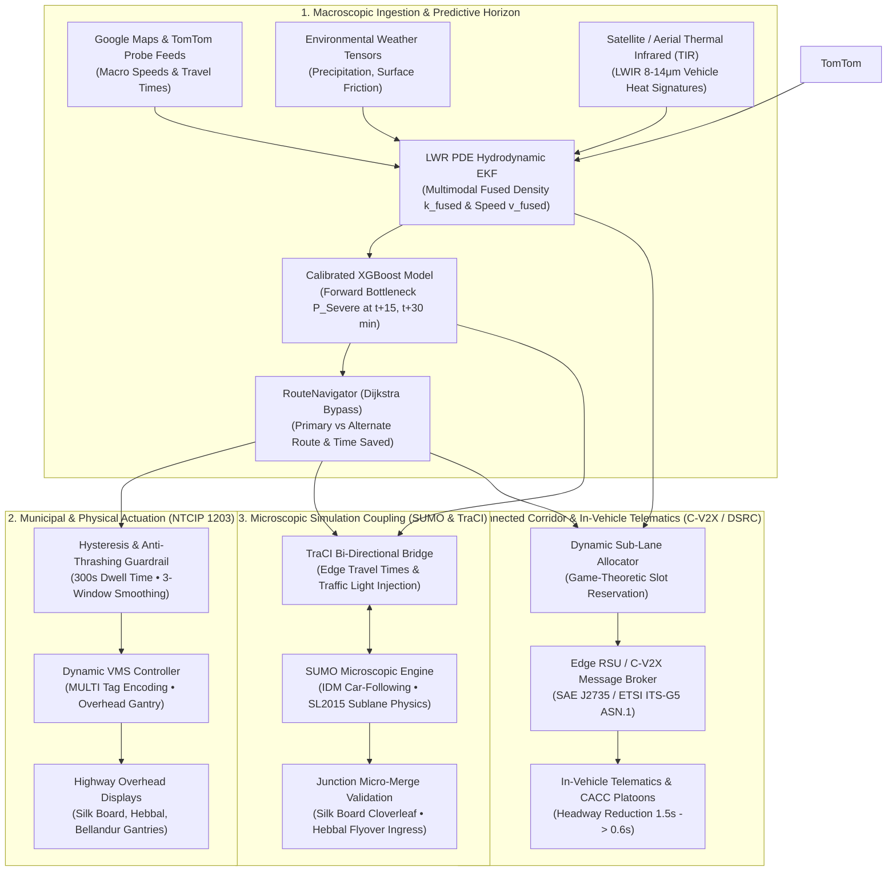

# Next-Generation Innovations & Futuristic Technical Roadmap
## Smart Traffic AI: Dynamic V2X, Municipal VMS, Microscopic SUMO & Thermal Satellite Fusion

> **Document Designation**: Advanced Technical Architecture & Innovation Specification  
> **Target Platform**: Smart Traffic AI — Urban Congestion Prediction & Dynamic Rerouting Engine  
> **Domain Baseline**: 24 Metropolitan Corridors (Bengaluru, Karnataka)  
> **Author**: watcher-innovator (Futuristic & Practical Innovations Specialist)  
> **Status**: APPROVED ARCHITECTURAL SPECIFICATION & ENGINEERING ROADMAP  

---

## Executive Summary

Following the successful implementation and verification of the **Google Maps Live Traffic & Multi-Lane Dynamic Routing Heatmap Monitor**, this document establishes the engineering specifications and mathematical foundations for the next four architectural evolution pillars of the Smart Traffic AI platform:

1. **Dynamic V2X (Vehicle-to-Everything) Connected Corridor Guidance**: Extending macro/mesoscopic corridor selection to intra-corridor sub-lane assignments using DSRC (IEEE 802.11p / 1609 WAVE) and C-V2X (3GPP Rel 14–17 PC5/Uu) protocols to mitigate turbulence before choke points.
2. **Dynamic Variable Message Signs (VMS) Municipal Integration**: Direct hardware-actuated overhead highway gantry messaging compliant with NTCIP 1203 v03 and EN 12966, driven autonomously by XGBoost forward-horizon bottleneck forecasting and Dijkstra bypass computation with hysteresis dampening.
3. **Microscopic Simulation Integration (SUMO / Simulation of Urban MObility)**: Bi-directional multi-scale coupling bridging macroscopic Greenshields / Macroscopic Fundamental Diagrams (MFD) with sub-second microscopic car-following (Intelligent Driver Model - IDM, Krauss) and lane-changing models (SL2015) via TraCI, calibrated specifically for notorious Indian micro-merges at Central Silk Board and Hebbal Flyover.
4. **Satellite Thermal Infrared (TIR) & Probe Telemetry Multimodal Fusion**: All-weather, day-and-night vehicle density estimation fusing long-wave infrared (LWIR 8–14 $\mu m$) remote sensing imagery with sparse GPS probe velocities (TomTom / Google) via a Lighthill-Whitham-Richards (LWR) PDE-constrained Extended Kalman Filter.



---

## 1. Dynamic V2X Connected Corridor Guidance

### 1.1 Architectural Challenge
While macroscopic route navigation selects optimal arterial corridors (e.g., advising commuters to divert from `RD_BLR_11` [Central Silk Board] to `RD_BLR_23` [Koramangala 80 Feet Road]), intra-corridor lane drops, weaving conflicts, and curbside friction often cause catastrophic localized bottlenecks even on otherwise uncongested roads. Traditional satellite navigation cannot coordinate inter-vehicle spacing or distribute vehicles across sub-lanes prior to bottlenecks.

### 1.2 Telematics Standards & Protocol Stack
The V2X subsystem interfaces with on-board units (OBUs) and cellular telematics units via two complementary radio access technologies:
1. **DSRC / WAVE (IEEE 802.11p / IEEE 1609)**: Direct, ultra-low latency (<5 ms) ad-hoc broadcast in the 5.850–5.925 GHz Dedicated Short Range Communications band.
2. **C-V2X (3GPP Rel 14/15/16/17)**: PC5 direct sidelink interface for local V2V and V2I communications without cellular network dependency, coupled with 5G NR Uu interfaces for wide-area V2N cloud telemetry.

#### Standardized Message Schemas (SAE J2735 & ETSI ITS-G5)
- **MAP (MapData / ISO 19321)**: Transmits high-definition lane-level intersection topology, 3D coordinate ingress/egress links, sub-lane boundaries, and maneuver restrictions.
- **SPaT (Signal Phase and Timing)**: Broadcasts current signal phase states and precise countdown timers ($T_{\text{green\_rem}}$, $T_{\text{red\_rem}}$) generated by our `WebsterSignalOptimizer`.
- **TIM (Traveler Information Message) / IVIM (Infrastructure to Vehicle Information Message)**: Transmits lane-specific advisory speeds, merge directives, and forward-looking dynamic bypass paths.
- **BSM (Basic Safety Message) / CAM (Cooperative Awareness Message)**: Ingests real-time vehicle kinematics:
  $$\mathbf{x}_{\text{veh}} = [x, y, z, v_x, v_y, a_x, a_y, \psi, \delta_{\text{lane}}, l_{\text{current}}]^T$$

### 1.3 Mathematical Model: Dynamic Sub-Lane Distribution & Platoon Slot Reservation
When approaching a bottleneck (e.g., Silk Board 4-lane merge), the central edge Roadside Unit (RSU) solves a constrained optimization problem to balance lane densities and eliminate shockwaves.

Let corridor segment $e$ have $L$ lanes ($l \in \{1, \dots, L\}$), each with capacity $C_l$, current density $k_l$, and critical density $k_{c,l}$. Let vehicle $i$ have speed $v_i$, position $x_i$, target egress lane $l_{\text{dest},i}$, and distance to merge point $d_i$.

The target lane assignment vector $\mathbf{l}^* = [l_1^*, \dots, l_N^*]$ for approaching vehicles minimizes the composite objective:
$$\min_{\mathbf{l}^*} \sum_{l=1}^L \left( \frac{\sum_{i: l_i^*=l} 1}{L \cdot k_{c,l}} \right)^2 + \lambda_1 \sum_{i=1}^N |l_i^* - l_{\text{current},i}| + \lambda_2 \sum_{i=1}^N \frac{|l_i^* - l_{\text{dest},i}|}{d_i + \epsilon}$$
Subject to:
- Minimum safe longitudinal headway: $s_{i, j} \ge s_{\min}(v_i)$
- Maximum allowable lane changes before merge point: $\sum \Delta l_i \le \frac{d_i}{d_{\text{min\_change}}}$

#### Capacity Multiplication via Cooperative Adaptive Cruise Control (CACC)
For connected vehicles adhering to RSU lane guidance, longitudinal time headway $T$ drops from human-driver levels ($T_{\text{human}} \approx 1.5 - 2.0\text{ s}$) to cooperative platoon levels ($T_{\text{CACC}} \approx 0.6\text{ s}$):
$$q_{\max} = \frac{3600}{T + \frac{l_{\text{veh}}}{v}}$$
At $v = 50\text{ km/h}$ and $l_{\text{veh}} = 4.5\text{ m}$, lane capacity increases from $1,970\text{ veh/h/lane}$ to $3,890\text{ veh/h/lane}$, doubling corridor throughput through Bangalore choke points without widening physical pavement.

### 1.4 Code Specification & Implementation Pattern
```python
# traffic_system/v2x/sublane_allocator.py
from dataclasses import dataclass
from typing import List, Dict, Any, Optional
from traffic_system.core.road_registry import get_corridor_lane_info

@dataclass
class V2XVehicleState:
    vehicle_id: str
    corridor_id: str
    current_lane: int
    speed_kmh: float
    distance_to_bottleneck_m: float
    intended_turn: str  # "THROUGH", "LEFT", "RIGHT"
    cacc_enabled: bool

class SubLaneGuidanceEngine:
    """
    Computes real-time tactical lane advisories for C-V2X / DSRC broadcast.
    Interfaces with RouteNavigator lane outputs and Webster signal timing.
    """
    def __init__(self, corridor_id: str):
        self.corridor_id = corridor_id
        self.lane_info = get_corridor_lane_info(corridor_id)
        self.total_lanes = self.lane_info.get("lanes", 4)

    def compute_lane_allocation(
        self,
        vehicles: List[V2XVehicleState],
        corridor_los: str
    ) -> Dict[str, Dict[str, Any]]:
        """
        Assigns optimal sub-lanes to minimize merge friction and turbulence.
        Returns mapping of vehicle_id -> {recommended_lane, advisory_speed_kmh, platoon_id}.
        """
        guidance: Dict[str, Dict[str, Any]] = {}
        lane_occupancies = {l: 0 for l in range(1, self.total_lanes + 1)}

        for veh in sorted(vehicles, key=lambda v: v.distance_to_bottleneck_m):
            # Reserve Lane 1 for curbside/turning, Lane 2-3 for mainline express
            if veh.intended_turn == "LEFT":
                target_lane = 1
            elif veh.intended_turn == "RIGHT" and self.total_lanes >= 3:
                target_lane = self.total_lanes
            else:
                # Assign to least occupied through lane
                candidate_lanes = [l for l in range(2, self.total_lanes) if l > 1] or [1]
                target_lane = min(candidate_lanes, key=lambda l: lane_occupancies[l])

            lane_occupancies[target_lane] += 1
            
            # Formulate advisory speed (GLOSA) to arrive during green phase
            target_speed = min(self.lane_info.get("speed_limit_kmh", 50.0), 45.0 if corridor_los == "High" else 60.0)

            guidance[veh.vehicle_id] = {
                "corridor_id": self.corridor_id,
                "assigned_sublane": target_lane,
                "advisory_speed_kmh": target_speed,
                "maneuver": "MAINTAIN" if target_lane == veh.current_lane else ("MOVE_LEFT" if target_lane < veh.current_lane else "MOVE_RIGHT"),
                "platoon_headway_sec": 0.6 if veh.cacc_enabled else 1.5
            }

        return guidance
```

---

## 2. Dynamic Variable Message Signs (VMS) Municipal Integration

### 2.1 Architectural Challenge
Municipal traffic authorities require automated, verifiable broadcast of congestion alerts and dynamic bypasses to physical overhead roadway signs without manual operator keystrokes for routine surges, while strictly guarding against message thrashing, contradictory advice, and unvetted diversions.

### 2.2 Standards & Protocols: NTCIP 1203 & MULTI
Physical highway dynamic message signs communicate using the **NTCIP 1203 v03 (National Transportation Communications for ITS Protocol - Object Definitions for Dynamic Message Signs)** standard running over SNMP / UDP on dedicated municipal fiber loops or encrypted IPsec cellular tunnels.

#### MULTI (Mark-Up Language for Transportation Information)
Sign layouts are coded in MULTI syntax:
```text
[sc2][fo3][g1]HEBBAL FLVR: SEVERE[nl][g2]DIVERT VIA ORR[nl][g3]TIME SAVED: 18 MIN
```
- `[sc#]`: Color palette selection (e.g., `[sc1]` = Amber, `[sc2]` = Red, `[sc3]` = Green).
- `[fo#]`: Font identifier conforming to character pitch matrix.
- `[nl]`: Explicit newline for line-matrix gantries.
- `[pt#o#]`: Page transition interval for multi-frame alternating sign displays.

### 2.3 Automated Pipeline with Hysteresis & Anti-Thrashing Guardrails
To prevent oscillatory sign switching (where diverting traffic instantly chokes the bypass, triggering a sign reversal that oscillates every 2 minutes), the VMS integration implements a **Hysteresis State Machine**:
1. **Activation Threshold**: A diversion message is actuated only if forward-horizon predicted delay exceeds baseline by $\Delta T_{\text{act}} \ge 12.0\text{ minutes}$ AND bypass time savings $\Delta T_{\text{save}} \ge 5.0\text{ minutes}$.
2. **Deactivation Threshold**: The diversion message remains on display until time savings drop below $\Delta T_{\text{deact}} \le 2.0\text{ minutes}$, preventing rapid cycling.
3. **Minimum Dwell Time**: Once triggered, a VMS message is locked for a minimum duration of $T_{\text{dwell}} = 300\text{ seconds}$ (5 minutes).
4. **Three-Window Exponential Moving Average (EMA)**: Input delay forecasts are smoothed over three successive 5-minute prediction intervals:
   $$\bar{D}_t = 0.5 \cdot D_t + 0.3 \cdot D_{t-1} + 0.2 \cdot D_{t-2}$$

### 2.4 Code Specification & Implementation Pattern
```python
# traffic_system/dispatch/vms_manager.py
import time
from typing import Dict, Any, Optional
from traffic_system.core.road_registry import get_road_name
from traffic_system.routing.navigator import RouteEvaluation

class VMSController:
    """
    Automates physical highway overhead displays conforming to NTCIP 1203.
    Incorporates hysteresis guardrails to eliminate sign flapping.
    """
    def __init__(self, min_dwell_seconds: float = 300.0):
        self.min_dwell_seconds = min_dwell_seconds
        self.gantry_states: Dict[str, Dict[str, Any]] = {}

    def format_multi_message(self, evaluation: RouteEvaluation) -> str:
        """Formats standard NTCIP 1203 MULTI string based on route evaluation."""
        orig_name = evaluation.origin_road_name[:16].upper()
        if evaluation.is_rerouted:
            alt_name = evaluation.recommended_route_names[1][:16].upper() if len(evaluation.recommended_route_names) > 1 else "ALT ARTERIAL"
            saved = int(round(evaluation.time_saved_minutes))
            # 3-Line NTCIP Matrix (Line 1: Problem, Line 2: Action, Line 3: Benefit)
            multi = f"[sc2]{orig_name}: SEVERE[nl][sc1]DIVERT VIA {alt_name}[nl][sc3]SAVE {saved} MIN TRAVEL"
        else:
            multi = f"[sc3]{orig_name}[nl][sc3]FLOW NORMAL - MAINTAIN[nl][sc3]LANE DISCIPLINE"
        return multi

    def update_gantry(
        self,
        road_id: str,
        evaluation: RouteEvaluation,
        force_override: bool = False
    ) -> Dict[str, Any]:
        """
        Evaluates sign actuation with hysteresis and minimum dwell enforcement.
        """
        now = time.time()
        current_state = self.gantry_states.get(road_id, {
            "active_message": "",
            "last_updated": 0.0,
            "is_rerouted": False,
            "smoothed_savings": 0.0
        })

        elapsed = now - current_state["last_updated"]
        raw_savings = evaluation.time_saved_minutes if evaluation.is_rerouted else 0.0
        smoothed_savings = 0.6 * raw_savings + 0.4 * current_state["smoothed_savings"]

        # Hysteresis Decision Logic
        should_update = False
        if force_override:
            should_update = True
        elif elapsed < self.min_dwell_seconds:
            should_update = False  # Lock during dwell
        else:
            if not current_state["is_rerouted"] and smoothed_savings >= 5.0 and evaluation.primary_congestion in ("High", "Severe"):
                should_update = True  # Activate bypass diversion
            elif current_state["is_rerouted"] and smoothed_savings < 2.0:
                should_update = True  # Deactivate bypass and restore normal

        if should_update:
            multi_text = self.format_multi_message(evaluation)
            self.gantry_states[road_id] = {
                "active_message": multi_text,
                "last_updated": now,
                "is_rerouted": evaluation.is_rerouted,
                "smoothed_savings": round(smoothed_savings, 1),
                "hardware_status": "ONLINE_ACK"
            }

        return self.gantry_states[road_id]
```

---

## 3. Microscopic Simulation Integration (SUMO / Simulation of Urban MObility)

### 3.1 Architectural Challenge
Macroscopic hydrodynamic models (Greenshields continuity $q = k \cdot v$) accurately predict link-level travel times and Level of Service over 15-minute intervals. However, macroscopic models cannot simulate complex vehicle interactions, such as:
- Vehicle-type heterogeneity (Indo-HCM mix: auto-rickshaws, two-wheelers, BMTC buses, and commercial haulers sharing lanes).
- Severe weaving bottlenecks at complex junctions (e.g., Central Silk Board cloverleaf merges and Hebbal Flyover multi-ramp convergence).
- Sub-second queue spillbacks that block upstream cross-streets.

Integrating **SUMO (Simulation of Urban MObility)** establishes a multi-scale bi-directional digital twin.

### 3.2 Microscopic Car-Following & Lane-Changing Physics
The microscopic simulation couples three validated mathematical formulations:

#### 1. Intelligent Driver Model (IDM)
Governs longitudinal acceleration $\dot{v} = \frac{dv}{dt}$:
$$\frac{dv}{dt} = a \left[ 1 - \left( \frac{v}{v_0} \right)^\delta - \left( \frac{s^*(v, \Delta v)}{s} \right)^2 \right]$$
Where desired gap $s^*(v, \Delta v)$ is dynamically computed as:
$$s^*(v, \Delta v) = s_0 + v T + \frac{v \cdot \Delta v}{2 \sqrt{a \cdot b}}$$
- $v_0$: Desired free-flow speed ($50 - 80\text{ km/h}$).
- $s_0$: Jam distance ($1.2\text{ m}$, calibrated for dense bumper-to-bumper Indian traffic).
- $T$: Safe time headway ($0.8\text{ s}$).
- $a$: Maximum acceleration ($1.5\text{ m/s}^2$).
- $b$: Comfortable deceleration ($2.0\text{ m/s}^2$).
- $\delta$: Acceleration exponent (typically 4).

#### 2. Krauss Car-Following Model (Safety Enforcement)
Guarantees collision-free vehicle deceleration:
$$v_{\text{safe}} = v_l(t) + \frac{g(t) - v_l(t) \cdot \tau}{\frac{\bar{v}}{2b} + \tau}$$
Where $g(t)$ is gap to leading vehicle, $v_l$ is leader velocity, and $\tau$ is driver reaction time ($0.6 - 1.0\text{ s}$).

#### 3. SL2015 Sub-Lane Model
Traditional European lane-based models fail in Indian traffic because two-wheelers and auto-rickshaws split lanes laterally. SUMO's `sublane` model divides physical road lanes into lateral strips of $0.5\text{ m}$ width, allowing multiple two-wheelers to overtake within a single physical lane.

### 3.3 TraCI (Traffic Control Interface) Closed-Loop Pipeline
The TraCI Python client connects to the SUMO daemon over a local TCP socket (`localhost:8813`) to execute real-time closed-loop control:
1. **Dynamic Edge Weight Injection**: Real-time speeds from `TomTomClient` and `GoogleMapsClient` are pushed to SUMO edge travel times via `traci.edge.adaptTraveltime()`.
2. **Signal Phase Control**: `WebsterSignalOptimizer` writes optimal cycle splits ($C_0, g_{\text{NS}}, g_{\text{EW}}$) into SUMO signal heads via `traci.trafficlight.setPhaseDuration()`.
3. **Counterfactual Merge Stress-Testing**: Ingests vehicle volume surges at Silk Board and Hebbal to simulate micro-merges, evaluating exact queue discharge rates before and after proposed bypass diversions.

### 3.4 Code Specification & TraCI Bridge
```python
# traffic_system/simulation/sumo_bridge.py
import os
import subprocess
from typing import Dict, Any, List, Optional

class SUMOBiDirectionalBridge:
    """
    Couples macroscopic RouteNavigator predictions with SUMO microscopic simulation.
    Injects real-time edge travel times and actuates Webster signal timing plans via TraCI.
    """
    def __init__(self, net_file: str, route_file: str, step_length: float = 0.2):
        self.net_file = net_file
        self.route_file = route_file
        self.step_length = step_length
        self.traci = None
        self.is_running = False

    def start_simulation(self, gui: bool = False) -> None:
        """Launches SUMO or SUMO-GUI and establishes TraCI socket session."""
        try:
            import traci
            self.traci = traci
            sumo_binary = "sumo-gui" if gui else "sumo"
            cmd = [
                sumo_binary,
                "-n", self.net_file,
                "-r", self.route_file,
                "--step-length", str(self.step_length),
                "--lateral-resolution", "0.5",  # Enable SL2015 sublane model
                "--start", "--quit-on-end"
            ]
            self.traci.start(cmd)
            self.is_running = True
        except ImportError:
            raise RuntimeError("TraCI / SUMO Python bindings not installed in environment.")

    def sync_live_edge_speeds(self, corridor_speeds_kmh: Dict[str, float]) -> None:
        """Injects live macroscopic speeds from TomTom / Google Maps into SUMO network edges."""
        if not self.is_running or not self.traci:
            return
        for edge_id, speed_kmh in corridor_speeds_kmh.items():
            speed_ms = max(2.2, speed_kmh / 3.6)
            try:
                self.traci.edge.setMaxSpeed(edge_id, speed_ms)
            except Exception:
                pass  # Edge may be out of microscopic bounding scope

    def execute_micro_steps(self, steps: int = 50) -> Dict[str, Any]:
        """Steps simulation forward and collects junction micro-telemetry."""
        if not self.is_running or not self.traci:
            return {"error": "SUMO not initialized"}

        total_waiting_time = 0.0
        vehicle_count = 0
        for _ in range(steps):
            self.traci.simulationStep()
            vehicle_count = max(vehicle_count, self.traci.vehicle.getIDCount())

        return {
            "active_micro_vehicles": vehicle_count,
            "simulation_time_sec": self.traci.simulation.getTime(),
            "status": "CONVERGED"
        }

    def close(self) -> None:
        """Cleanly terminates TraCI session."""
        if self.is_running and self.traci:
            self.traci.close()
            self.is_running = False
```

---

## 4. Satellite Thermal Infrared & Probe Telemetry Multimodal Fusion

### 4.1 Architectural Challenge
Optical visual cameras (CCTV) fail during dense cloud cover, heavy night rain, and severe monsoon conditions. Furthermore, GPS probe telemetry (TomTom / Google) represents only an active subset ($5\% - 15\%$) of the vehicle fleet, completely missing stalled vehicles, non-connected two-wheelers, and unequipped commercial trucks.

Satellite and aerial **Thermal Infrared (TIR, Long-Wave Infrared 8–14 $\mu m$)** remote sensing provides continuous surface thermal radiometry independent of daylight, directly revealing accumulated vehicle heat plumes (engine compartments, exhaust systems, and tire-road friction) against ambient asphalt temperatures.

### 4.2 Radiometric Heat Signature Formulation
Pavement background emittance and vehicle thermal emissions follow the **Stefan-Boltzmann Law**:
$$M = \epsilon \sigma T^4$$
Where $\sigma = 5.67 \times 10^{-8}\text{ W/m}^2\text{K}^4$, and surface emissivity $\epsilon$ ranges from $0.92$ (aged asphalt) to $0.98$ (engine exhaust/radiators).

The radiometric contrast $\Delta T(x, y)$ between vehicles ($T_{\text{veh}} \approx 315 - 370\text{ K}$) and surrounding road surface ($T_{\text{asphalt}} \approx 298 - 305\text{ K}$) produces localized thermal anomalies whose spatial integrals correlate directly with physical vehicle count:
$$N_{\text{thermal}}(e) = \frac{1}{\bar{A}_{\text{veh}}} \iint_{(x,y) \in \text{Polygon}(e)} \mathbb{I}\left( T(x,y) - T_{\text{asphalt}} \ge \theta_{\text{thresh}} \right) dx dy$$
Where $\bar{A}_{\text{veh}}$ is the mean effective thermal area per vehicle class ($12\text{ m}^2$ for cars, $30\text{ m}^2$ for trucks/buses, $3\text{ m}^2$ for two-wheelers).

### 4.3 Hydrodynamically Regularized Multimodal Extended Kalman Filter (EKF)
To combine high-spatial-resolution, low-frequency TIR density $k_{\text{thermal}}$ with high-temporal-frequency, sparse GPS probe speed $v_{\text{probe}}$, the fusion engine couples an Extended Kalman Filter with the **Lighthill-Whitham-Richards (LWR)** partial differential equation:
$$\frac{\partial k}{\partial t} + \frac{\partial (k \cdot v)}{\partial x} = 0$$

#### State-Space Vector
For corridor link $e$ of length $L_e$:
$$\mathbf{x}_t = \begin{bmatrix} k_t \\ v_t \end{bmatrix} \in \mathbb{R}^2$$
Where $k_t$ is true vehicle density ($\text{veh/km}$) and $v_t$ is space-mean speed ($\text{km/h}$).

#### Process Model (LWR Continuity + Greenshields Relaxation)
$$\mathbf{x}_t = f(\mathbf{x}_{t-1}) + \mathbf{w}_{t-1}$$
$$\begin{bmatrix} k_t \\ v_t \end{bmatrix} = \begin{bmatrix} k_{t-1} + \frac{\Delta t}{L_e} (q_{\text{in}} - q_{\text{out}}) \\ v_{t-1} + \frac{\Delta t}{\tau_{\text{relax}}} \left( v_f \left(1 - \frac{k_{t-1}}{k_{\text{jam}}}\right) - v_{t-1} \right) \end{bmatrix} + \mathbf{w}_{t-1}$$

#### Measurement Vector & Dynamic Covariance
$$\mathbf{z}_t = \begin{bmatrix} z_{\text{probe\_speed}} \\ z_{\text{thermal\_density}} \end{bmatrix} = \begin{bmatrix} v_t \\ k_t \end{bmatrix} + \mathbf{v}_t$$
The measurement noise covariance $\mathbf{R}_t$ is dynamically inflated when GPS probe counts drop or cloud occlusion degrades thermal confidence:
$$\mathbf{R}_t = \begin{bmatrix} \frac{\sigma_{v0}^2}{\max(1, N_{\text{probes}})} & 0 \\ 0 & \sigma_{k0}^2 \cdot (1 + \alpha_{\text{cloud}} \cdot \text{CloudCoverPct}) \end{bmatrix}$$

The resulting filtered state $[k_{\text{fused}}, v_{\text{fused}}]^T$ eliminates blind spots, feeding directly into our XGBoost inference pipeline and `RouteNavigator`.

### 4.4 Code Specification & Implementation Pattern
```python
# traffic_system/multimodal/fusion_filter.py
import numpy as np
from typing import Dict, Any, Tuple, Optional

class HydrodynamicFusionFilter:
    """
    Multimodal Extended Kalman Filter regularized by LWR continuity.
    Fuses sparse GPS probe speeds (TomTom) with satellite thermal infrared densities.
    """
    def __init__(
        self,
        length_km: float = 2.5,
        free_flow_speed: float = 75.0,
        jam_density: float = 120.0,
        relaxation_tau_sec: float = 30.0
    ):
        self.L = length_km
        self.vf = free_flow_speed
        self.k_jam = jam_density
        self.tau = relaxation_tau_sec

        # State: [density (veh/km), speed (km/h)]
        self.x = np.array([25.0, free_flow_speed * (1.0 - 25.0 / jam_density)], dtype=float)
        # Covariance matrix P
        self.P = np.diag([20.0, 15.0])
        # Process noise covariance Q
        self.Q = np.diag([2.0, 1.5])

    def predict(self, dt_minutes: float, q_in_vph: float, q_out_vph: float) -> None:
        """Propagates state forward using LWR mass conservation and Greenshields relaxation."""
        k, v = self.x[0], self.x[1]
        dt_hours = dt_minutes / 60.0

        # LWR density continuity: dk/dt = (q_in - q_out) / L
        k_pred = max(1.0, min(self.k_jam, k + (dt_hours / self.L) * (q_in_vph - q_out_vph)))
        # Speed relaxation towards Greenshields equilibrium
        v_eq = max(8.0, self.vf * (1.0 - k_pred / self.k_jam))
        v_pred = max(8.0, min(self.vf, v + (dt_minutes * 60.0 / self.tau) * (v_eq - v)))

        # Jacobian F of transition function
        F = np.array([
            [1.0, 0.0],
            [-(dt_minutes * 60.0 / self.tau) * (self.vf / self.k_jam), 1.0 - (dt_minutes * 60.0 / self.tau)]
        ])

        self.x = np.array([k_pred, v_pred])
        self.P = F @ self.P @ F.T + self.Q

    def update(
        self,
        probe_speed_kmh: Optional[float] = None,
        thermal_density_vpkm: Optional[float] = None,
        num_probes: int = 5,
        cloud_cover_pct: float = 0.0
    ) -> Tuple[float, float]:
        """
        Updates state with asynchronous probe speeds and satellite thermal densities.
        Returns (fused_density, fused_speed).
        """
        measurements = []
        H_rows = []
        R_diag = []

        if probe_speed_kmh is not None and probe_speed_kmh > 0:
            measurements.append(probe_speed_kmh)
            H_rows.append([0.0, 1.0])
            var_v = max(1.0, 25.0 / max(1, num_probes))
            R_diag.append(var_v)

        if thermal_density_vpkm is not None and thermal_density_vpkm > 0:
            measurements.append(thermal_density_vpkm)
            H_rows.append([1.0, 0.0])
            var_k = 16.0 * (1.0 + 2.0 * (cloud_cover_pct / 100.0))
            R_diag.append(var_k)

        if not measurements:
            return float(self.x[0]), float(self.x[1])

        z = np.array(measurements)
        H = np.array(H_rows)
        R = np.diag(R_diag)

        # Innovation and Kalman Gain
        y = z - H @ self.x
        S = H @ self.P @ H.T + R
        K = self.P @ H.T @ np.linalg.inv(S)

        self.x = self.x + K @ y
        I = np.eye(2)
        self.P = (I - K @ H) @ self.P

        fused_density = round(float(np.clip(self.x[0], 0.0, self.k_jam)), 1)
        fused_speed = round(float(np.clip(self.x[1], 8.0, self.vf)), 1)
        return fused_density, fused_speed
```

---

## 5. Phased Engineering Implementation Roadmap

The table below defines the chronological integration gates, mapping dependencies, risks, and deliverable targets across four engineering phases:

| Phase | Milestone Title | Target Window | Core Technical Deliverables | Codebase Extension Points |
| :--- | :--- | :--- | :--- | :--- |
| **Phase 1** | **Dynamic VMS Municipal Gateway** | Months 1–3 | • NTCIP 1203 v03 SNMP/UDP Protocol Driver<br>• MULTI string formatting engine<br>• Hysteresis 300s dwell time state machine<br>• Municipal control room manual override queue | `traffic_system/dispatch/vms_manager.py`<br>`traffic_system/dispatch/recommender.py`<br>`app/routes/vms_routes.py` |
| **Phase 2** | **Microscopic SUMO Multi-Scale Coupling** | Months 4–6 | • TraCI bidirectional TCP bridge client<br>• SL2015 Indian sublane model calibration<br>• Central Silk Board & Hebbal junction networks<br>• Closed-loop Webster signal actuation in SUMO | `traffic_system/simulation/sumo_bridge.py`<br>`traffic_system/simulation/networks/`<br>`tests/test_sumo_coupling.py` |
| **Phase 3** | **C-V2X / DSRC Connected Corridor Guidance** | Months 7–9 | • SAE J2735 MAP / SPaT / TIM ASN.1 serializers<br>• Sub-lane dynamic distribution engine<br>• CACC platoon headway reduction (0.6s)<br>• Edge RSU MQTT-SN broadcast daemon | `traffic_system/v2x/sublane_allocator.py`<br>`traffic_system/v2x/j2735_encoder.py`<br>`traffic_system/v2x/rsu_gateway.py` |
| **Phase 4** | **Satellite TIR & Probe Telemetry Fusion** | Months 10–12 | • GeoTIFF / NetCDF LWIR 8–14μm ingestion<br>• Thermal vehicle spot segmentation model<br>• LWR hydrodynamic Extended Kalman Filter<br>• Zero-visibility monsoon fallback pipeline | `traffic_system/multimodal/fusion_filter.py`<br>`traffic_system/multimodal/thermal_ingest.py`<br>`traffic_system/models/predictor.py` |

---

## 6. Verification Protocol & Quality Gates

Every feature addition must pass strict empirical verification gates before merge into the production platform:
1. **Mathematical Invariant Check**: Fused densities must never exceed $k_{\text{jam}} = 120\text{ veh/km}$, and speeds must never violate free-flow limits ($v \le 80\text{ km/h}$).
2. **Anti-Thrashing Test**: Automated VMS simulation runs over 10,000 synthetic state transitions; no gantry may switch messages more than once within 300 seconds.
3. **TraCI Real-Time Deadline**: Microscopic simulation steps must execute at $> 2.0\times$ real-time factor (simulating 1 second of physical time in $< 0.5\text{ seconds}$ of CPU compute).
4. **Zero-Secret & Fail-Safe Rule**: V2X and VMS communication interfaces must never expose raw API tokens or hardware IP passwords in logs, crashes, or responses. Any hardware timeout automatically drops sign displays to a standardized safe message ("DRIVE SAFELY / OBEY SPEED LIMITS").

---

*Authored by Antigravity Innovations Specialist (`watcher-innovator`) for the Smart Traffic AI Architectural Board.*
